Junior AI and Machine Learning engineer focused on Generative AI: RAG systems, LLM agents, and computer vision models served through FastAPI and Docker. I work with LangChain, LangGraph, n8n, Hugging Face, vector databases, and local models through Ollama.

Completed the 220-hour Master Machine Learning and AI Diploma at AMIT Learning, Bachelor of Computer Science (2024), and Egyptian military service (March 2026). Open to junior AI and GenAI roles in Egypt, remote, or abroad.

<table>
<tr>
<td width="50%"></td>
<td width="50%"></td>
</tr>
<tr>
<td width="50%"></td>
<td width="50%"></td>
</tr>
<tr>
<td width="50%"></td>
<td width="50%"></td>
</tr>
</table>

- Deep Learning Applications for Computer Vision, University of Colorado Boulder (Mar 2024)
- Deep Learning Fundamentals, DeepLearning.AI (Jan 2024)
- Introduction to Computer Vision and Image Processing, IBM (Jan 2024)
- Associate Data Scientist in Python, DataCamp (Dec 2023)
- Data Analyst with Python, DataCamp (Dec 2023)

